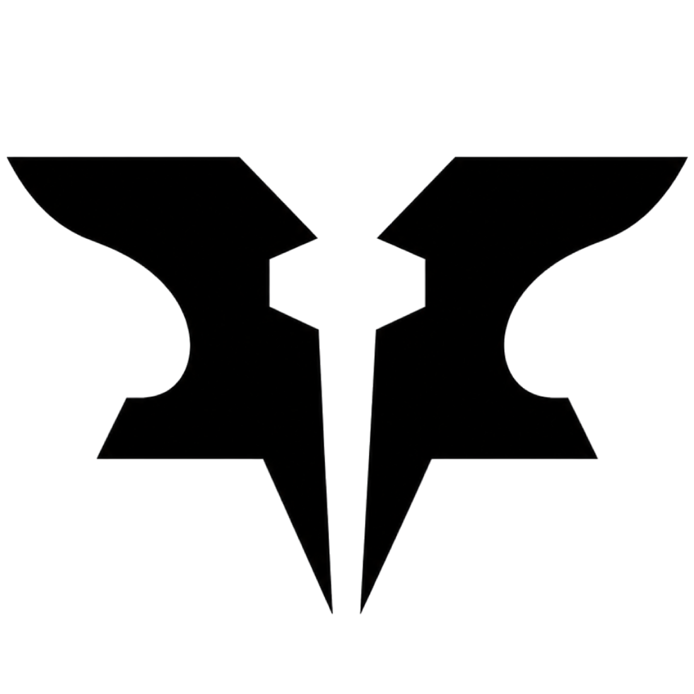

  

<h1 align="center">Framelab</h1>

  <strong>Unofficial Warframe site</strong> for Forge loadouts, fashion, Arena, 
  gear catalog, Market &amp; Warframe.market desk, Riven Judge, groups, and creator tools.

  <a href="https://framelab-app.thefrenchies.org/">Open the site</a>
  ·
  <a href="https://github.com/FL-Framelab/framelab">Source</a>
  ·
  <a href="https://www.patreon.com/cw/Framelaboffi">Patreon</a>
  ·
  <a href="https://discord.gg/8g9geKncZA">Discord</a>

  
  
  

---

### Who is Framelab?

Framelab is the group behind the website — the product team. Today that is one person designing, building, hosting, and shipping it. Hosting is not paid by an outside company.

[TheFrenchies](https://www.youtube.com/@thefrenchiesoffi) helped the site get started and still help with press and outreach. They are a linked multi-game house for community and content. They are not the product team, and they do not fund Framelab.

Not affiliated with Digital Extremes.

### What is Framelab?

A place to plan Warframe and share it with other Tenno: forge a loadout, publish a look, vote in Arena, shop a list on Market, judge a Riven, keep a group room, or attach a stream to a build. Item names and figures come from the Warframe wiki. The site is in beta; big changes show up in the changelog and Forum notes.

Forge and build shopping stay free. [Patreon](https://www.patreon.com/cw/Framelaboffi) is optional — Forma+ opens custom bulk Market lists and a few extra storage / alert caps.

### On the site

| | |
| :--- | :--- |
| **Forge** | Build and publish loadouts — mods, Helminth, Rivens, guides, share codes |
| **Fashion** | Assemble looks and share previews from each Gear item’s Fashion tab |
| **Gear** | Wiki-backed catalog of frames, weapons, mods, arcanes, and more |
| **Arena** | Monthly contests and a global tier list for builds and fashion |
| **Market** | Build shopping lists, linked Warframe.market desk, Forma+ custom bulk lists |
| **Riven Judge** | Rate and train Rivens |
| **Groups** | Clans and crews with shared rooms |
| **Creator** | Profile links and video attachments for streams and guides |
| **Updates** | Catalog alerts when wiki data touches your saved builds |
| **Tools** | Craft calculator, comparator, screenshot capture into the Forge |

### Elsewhere

| | |
| :--- | :--- |
| Site | [framelab-app.thefrenchies.org](https://framelab-app.thefrenchies.org/) |
| Code | [FL-Framelab/framelab](https://github.com/FL-Framelab/framelab) |
| Patreon | [patreon.com/cw/Framelaboffi](https://www.patreon.com/cw/Framelaboffi) |
| Discord | [TheFrenchies Discord](https://discord.gg/8g9geKncZA) (Framelab channels live there) |
| About | [Who we are on the site](https://framelab-app.thefrenchies.org/about) |

  Warframe and all related materials are trademarks of Digital Extremes Ltd. Framelab is a fan project and is not endorsed by Digital Extremes.

